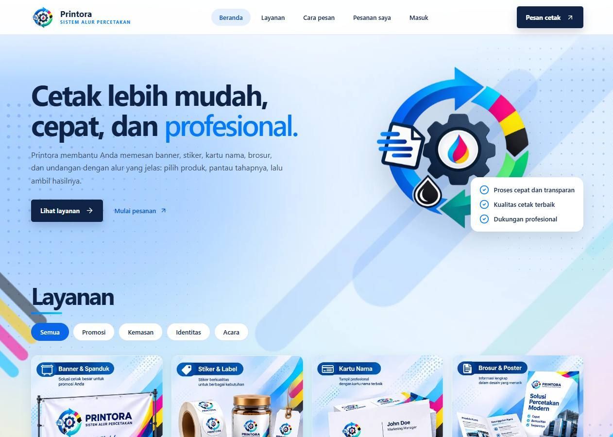
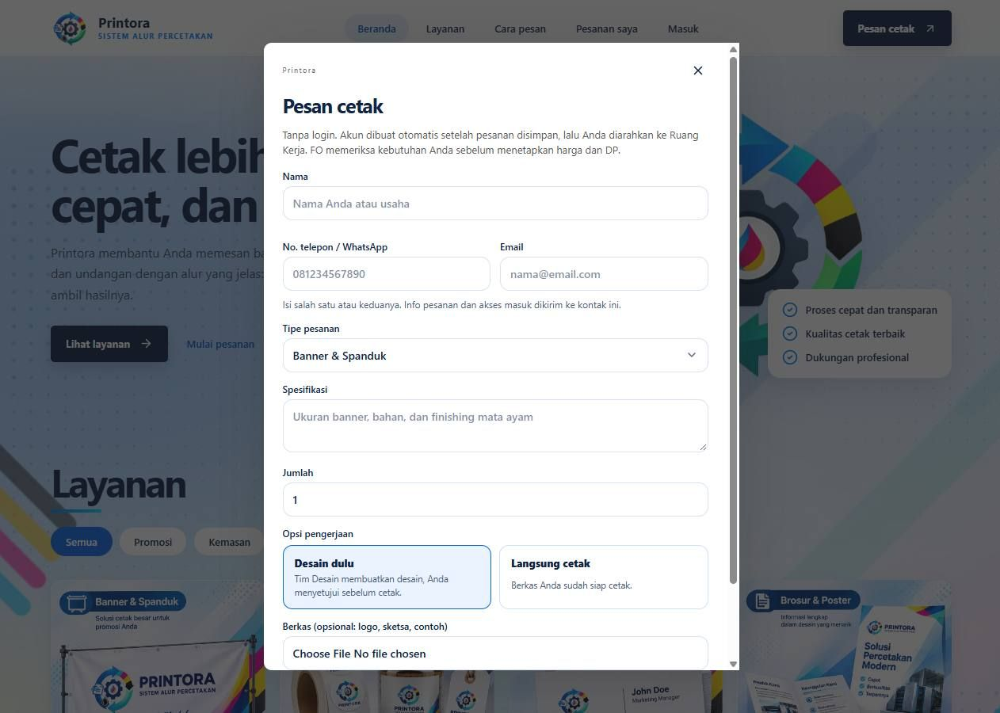
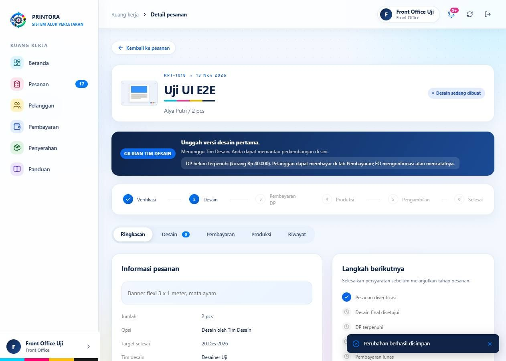
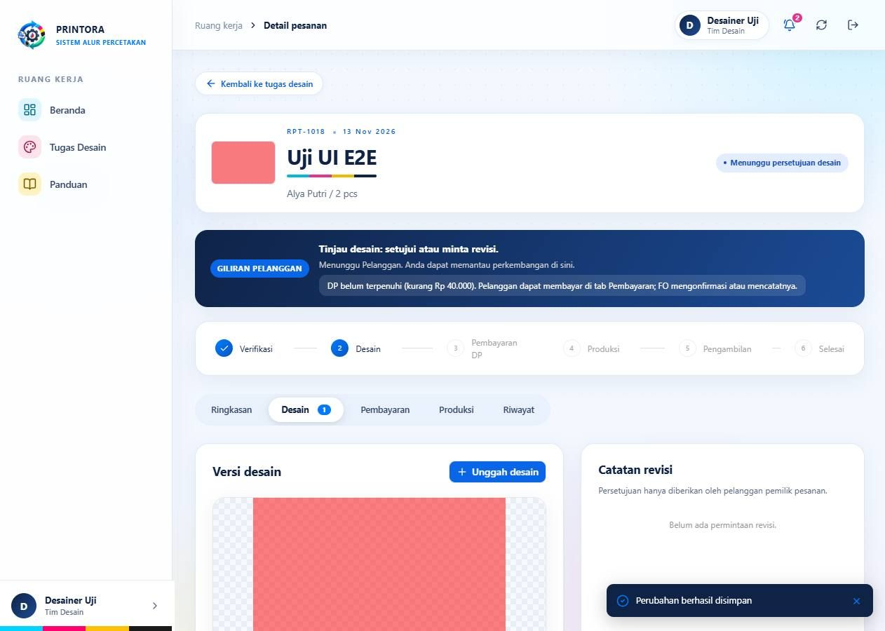
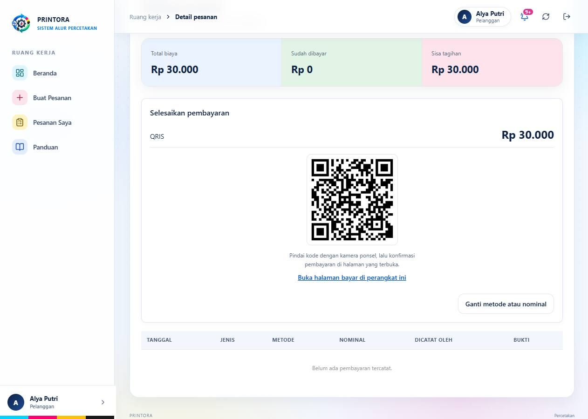
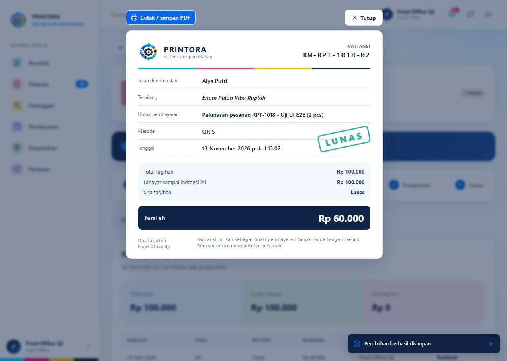
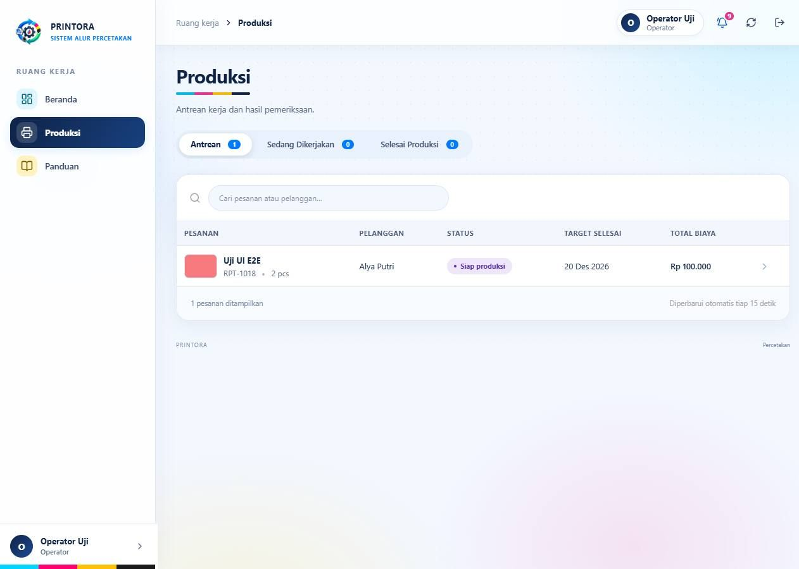
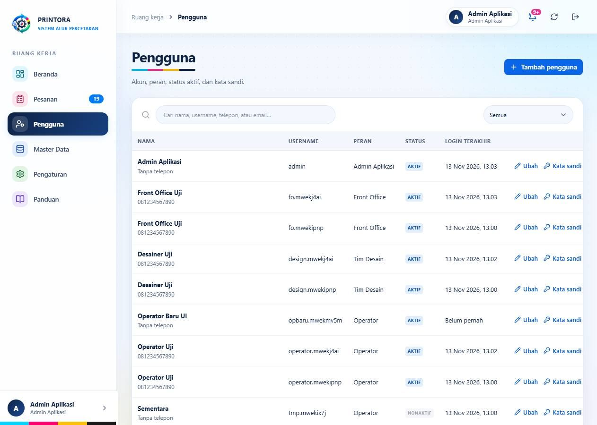
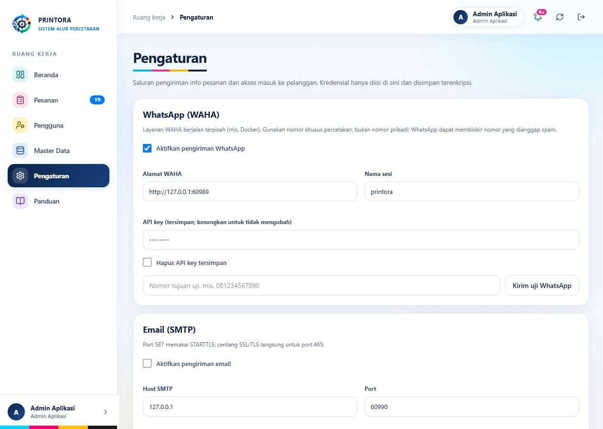
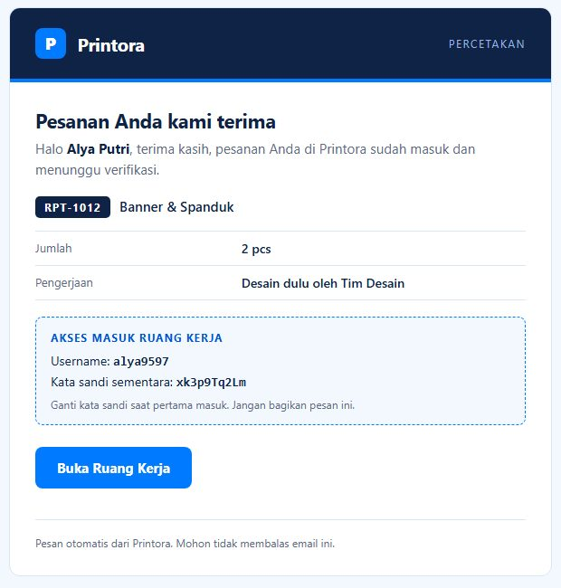

# Printora

            [](LICENSE)

Sistem alur pesanan percetakan berbasis web (studi kasus Rumah Printing Tajinan, mata kuliah Rekayasa Perangkat Lunak, Kelompok 2). Pelanggan, Front Office, Tim Desain, Operator, dan Admin bekerja dalam satu nomor pesanan: pesan, desain atau berkas siap cetak, pembayaran (DP dan pelunasan, dengan kwitansi), produksi, hingga pengambilan. Pemberitahuan dikirim lewat WhatsApp dan email di tiap tahap.

## Fitur

- Etalase publik: pilih layanan dan pesan tanpa mendaftar. Akun pelanggan dibuat otomatis.
- Dua jalur pesanan: **Desain dulu** (versi, revisi, persetujuan) atau **Langsung cetak** (berkas siap cetak).
- Pembayaran DP dan pelunasan (Transfer, Tunai, QRIS simulasi) dengan kwitansi bernomor yang bisa dicetak.
- Produksi: antrean operator, pencatatan kendala, pemeriksaan hasil, dan serah terima.
- Notifikasi WhatsApp dan email di setiap tahap, lengkap dengan riwayat pengiriman.
- Ruang admin: pengguna, katalog layanan, metode pembayaran, dan pengaturan saluran notifikasi.

## Tampilan

| | |
|---|---|
| <br>**Etalase layanan** | <br>**Form pesan tanpa login** |
| <br>**Verifikasi Front Office** | <br>**Versi desain dan revisi** |
| <br>**Pembayaran QRIS** | <br>**Kwitansi LUNAS** |
| <br>**Antrean produksi** | <br>**Admin: pengguna** |
| <br>**Admin: WhatsApp dan SMTP** | <br>**Email notifikasi** |

Layar masuk: [docs/tampilan/screenshots/00-login.jpg](docs/tampilan/screenshots/00-login.jpg). Rekaman alur lengkap: [docs/tampilan/rekaman-alur-ui.gif](docs/tampilan/rekaman-alur-ui.gif).

## Teknologi

| Bagian | Teknologi |
|---|---|
| Frontend | React 19, Next.js 16 (App Router) lewat vinext/Vite, Tailwind CSS 4, shadcn/ui, Radix UI |
| Backend | Node.js ≥ 22.13, route handler Next.js, logika di `lib/` |
| Basis data | MySQL 8.4 (driver mysql2, skema dibuat otomatis oleh `lib/mysql.mjs`) |
| Notifikasi | Email (nodemailer, SMTP) dan WhatsApp (WAHA, mesin NOWEB) |
| Deploy | Docker Compose (app, MySQL, WAHA, Cloudflare Tunnel) |

## Peran

Admin Aplikasi, Front Office, Pelanggan, Tim Desain, dan Operator. Tidak ada pendaftaran mandiri: akun pelanggan dibuat otomatis saat memesan dari etalase (kata sandi sementara dikirim lewat WhatsApp/email dan wajib diganti), akun staf dibuat Admin.

## Menjalankan dengan Docker

```bash
cp .env.docker.example .env.docker      # isi semua sandi dan SETTINGS_KEY (64 karakter heksa, jangan diganti setelahnya)
docker compose --env-file .env.docker up -d --build
```

Etalase di http://127.0.0.1:8787 dan ruang staf di `/operasional`. Alamat publik sementara: `npm run tunnel`. Rincian, termasuk WAHA dan tunnel, ada di [docs/panduan/deploy-docker.md](docs/panduan/deploy-docker.md).

## Menjalankan lokal (pengembangan)

Butuh Node ≥ 22.13 dan MySQL 8.

```bash
cp .env.example .env     # isi MYSQL_PASSWORD dan ADMIN_PASSWORD
npm install
npm run db:migrate
npm run build && npm start     # http://127.0.0.1:8787 (npm run dev untuk port 5173)
```

`npm run db:reset` mengosongkan semua data. Jalankan hanya pada basis data uji.

## Pengujian

Gunakan basis data terpisah (misalnya `printora_test`) dan server yang berjalan.

```bash
node --experimental-strip-types --no-warnings scripts/test-domain.mjs   # logika domain
node scripts/test-e2e.mjs                                               # API, 154 kasus
node scripts/e2e-ui.mjs http://127.0.0.1:8787                           # UI (Chrome headless), 47 langkah
```

Hasil terakhir: domain lulus, API 154/154, UI 47/47.

## Dokumentasi

Indeks lengkap ada di [docs/README.md](docs/README.md).

- [Laporan proyek RPL](docs/laporan/laporan-proyek-rpl.pdf) (docx tersedia) dan [aktor dan menu sistem](docs/laporan/aktor-dan-menu-sistem.pdf).
- [Diagram](docs/diagram): use case, class, activity, dan sequence.
- [Test case API](docs/pengujian/test-case-api-e2e.md) dan [test case alur lengkap](docs/pengujian/test-case-alur-lengkap.docx).
- [Catatan prototipe](docs/panduan/prototipe.md) dan [panduan deploy Docker](docs/panduan/deploy-docker.md).
- [Tangkapan layar aplikasi](docs/tampilan/screenshots).
- [Slide presentasi](docs/presentasi/printora.pptx), [rekaman alur UI](docs/tampilan/rekaman-alur-ui.gif), dan contoh email/WhatsApp di [docs/tampilan/email](docs/tampilan/email).
- [LICENSE](LICENSE) (MIT) dan [THIRD_PARTY_LICENSES.md](THIRD_PARTY_LICENSES.md).
- [AI_USAGE.md](AI_USAGE.md): pernyataan penggunaan AI. [CHANGELOG.md](CHANGELOG.md): riwayat perubahan.

## Keamanan sebelum dipakai sungguhan

Ganti semua sandi contoh, set `ENABLE_DEMO_PAY=0` (QRIS simulasi), jangan membuka port WAHA (3000) ke publik, dan pakai nomor WhatsApp yang sudah mapan. Berkas `.env*` tidak masuk git.

## Tim

Andika Setiawan (252011001) dan Ivan Dika Pratama (252011082). Dosen pengampu: Fadhli Almu'iini Ahda, S.Kom., M.Kom.
